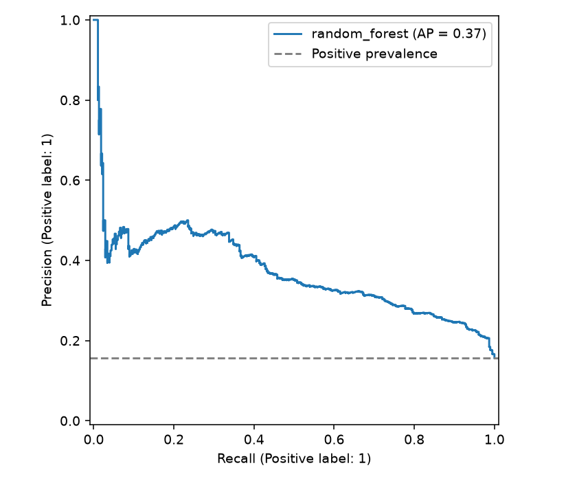
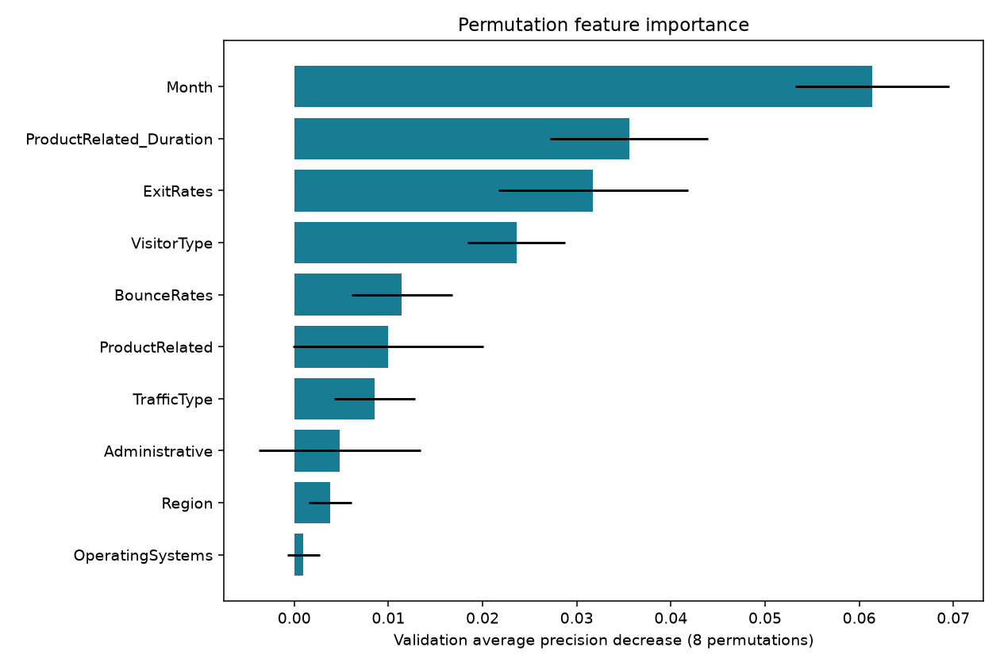

# 온라인 쇼핑몰 구매 전환 성능 평가서

## 문제와 데이터
양성은 **구매(Revenue=True)**입니다. 원본 12,330행에서 입력·타깃이 동일한 중복 125행, 동일 입력의 상충 타깃 0행을 제거해 12,205행을 사용했습니다. 결측 셀은 0개, 양성 비율은 15.63%입니다. 원본 인덱스와 분할은 `split_manifest.csv`, 원본 파일 SHA-256은 `metrics.json`에 기록했습니다.

## 평가 설계
`random_state=42`로 양성 비율을 유지하여 학습/검증/테스트를 60/20/20으로 분리했습니다. 실제 건수는 {'train': 7323, 'validation': 2441, 'test': 2441}입니다. 스케일러·결측 대체·인코더는 Pipeline 안에서 학습 세트로만 적합합니다. EDA도 학습 세트만 사용합니다.
모델은 검증 **Average Precision(AP)** 최대값으로 선택하고, 선택 모델의 임계값은 검증 F1이 최대인 값(0.10~0.90, 간격 0.05)으로 정했습니다. 동률이면 큰 임계값을 사용합니다. AP는 불균형 데이터의 순위 품질을 측정하며, 사다리꼴 PR-AUC와 계산이 다릅니다.
최종 선택은 **random_forest**, 임계값은 **0.20**입니다. 테스트 결과는 선택에 사용하지 않았고, 검증 중요도 평가를 위해 최종 모델을 학습+검증으로 재적합하지 않았습니다. 무제한 트리는 과적합 관찰용으로 선택 대상에서 제외했습니다.

## 모델 비교 — 공통 임계값 0.50
| model | train_f1 | validation_f1 | validation_average_precision | test_accuracy | test_f1 |
| --- | --- | --- | --- | --- | --- |
| dummy | 0.0000 | 0.0000 | 0.1561 | 0.8435 | 0.0000 |
| logistic_unscaled | 0.0530 | 0.0451 | 0.3170 | 0.8431 | 0.0543 |
| logistic_scaled | 0.0579 | 0.0447 | 0.3416 | 0.8443 | 0.0640 |
| tree_depth_3 | 0.0000 | 0.0000 | 0.2765 | 0.8435 | 0.0000 |
| tree_depth_5 | 0.1970 | 0.1522 | 0.3294 | 0.8353 | 0.1625 |
| tree_depth_8 | 0.3596 | 0.2019 | 0.3196 | 0.8275 | 0.2442 |
| tree_unrestricted_diagnostic | 1.0000 | 0.2606 | 0.1827 | 0.7689 | 0.2824 |
| random_forest | 0.0593 | 0.0104 | 0.3684 | 0.8447 | 0.0207 |

모든 후보는 같은 분할을 사용합니다. 아래 최종 성능은 조정 임계값을 사용하므로 위 표의 0.50 결과와 다를 수 있습니다. 스케일링 비교는 같은 LogisticRegression 설정에서 수행합니다. 표준화는 각 특성을 학습 평균 0·표준편차 1로 바꾸며, 정규화 제약과 최적화에 영향을 줍니다. 트리는 분기 순서를 사용하므로 스케일링을 생략했습니다.
수렴 경고가 나온 후보: **logistic_unscaled**. 경고가 있는 비표준화 LogisticRegression은 최적화가 완료되지 않은 비교 실험이며, 그 성능을 수렴한 모델의 확정적 한계로 해석하지 않습니다. `model_comparison.csv`의 convergence_warning 열에도 기록했습니다.

## 최종 테스트 성능
| 정확도 | 정밀도 | 재현율 | F1 | ROC-AUC | AP |
| --- | --- | --- | --- | --- | --- |
| 0.7218 | 0.3169 | 0.6728 | 0.4308 | 0.7794 | 0.3723 |

혼동 행렬의 행은 실제, 열은 예측이며 순서는 음성(0), 양성(1)입니다: **TN=1505, FP=554, FN=125, TP=257**.
다수 클래스 기준 모델의 테스트 정확도는 **0.8435**입니다. 최종 정확도가 이보다 낮아도 양성 탐지 F1과 재현율이 개선될 수 있습니다. 이 선택은 매출이나 비용 최적화를 의미하지 않습니다.
정밀도 TP/(TP+FP)는 양성 예측의 적중률, 재현율 TP/(TP+FN)는 실제 양성을 찾아낸 비율입니다. FP는 구매하지 않을 고객에게 캠페인 비용을 사용하는 오류, FN은 잠재 구매자를 놓치는 오류입니다.

## 과적합과 오답 노트
무제한 트리의 학습 F1=1.0000, 검증 F1=0.2606입니다. 깊이 3·5·8 및 최소 잎 표본 10으로 제한한 트리와 비교해 일반화 차이를 확인합니다.
테스트 오답 679건 전체를 `misclassified.csv`에 저장했습니다. FP/FN, 실제값, 예측값, 확률, 원본 행 번호와 입력 성분/행동을 확인할 수 있습니다. 확신이 큰 오답 5건은 다음과 같습니다.

| source_row | actual | predicted | probability | error_type |
| --- | --- | --- | --- | --- |
| 10615 | 1 | 0 | 0.0117 | FN |
| 7600 | 1 | 0 | 0.0126 | FN |
| 2950 | 1 | 0 | 0.0268 | FN |
| 11798 | 1 | 0 | 0.0303 | FN |
| 7180 | 1 | 0 | 0.0414 | FN |

오답은 추가 확인 대상이며, 관측하지 않은 원인을 단정하지 않습니다. 확률은 보정하지 않은 모델 출력입니다. 이번 테스트로 수정 방향을 정했다면 다음 버전에는 새로운 홀드아웃이 필요합니다.

## 주요 특성과 활용
검증 세트 원본 열을 하나씩 섞었을 때 AP 하락량을 8회 측정했습니다. 음수는 중요도가 안정적이지 않을 수 있음을 뜻하며, 상관된 열은 중요도를 나눠 가질 수 있습니다.

| feature | mean_ap_decrease | std_ap_decrease |
| --- | --- | --- |
| Month | 0.0614 | 0.0082 |
| ProductRelated_Duration | 0.0356 | 0.0084 |
| ExitRates | 0.0317 | 0.0101 |
| VisitorType | 0.0236 | 0.0052 |
| BounceRates | 0.0114 | 0.0054 |

상위 특성에 따라 상품 탐색 동선, 상세 페이지 정보, 재방문 경험을 점검하는 실험 가설을 세울 수 있습니다. 체류 시간을 늘리면 구매가 늘어난다는 인과 결론은 아닙니다. 쿠폰 비용·구매 이익 데이터가 없으므로 매출 개선액이나 ROI를 추정하지 않았습니다.

- `Month`: 계절·캠페인 시기별 구매 패턴의 차이를 점검하되, 월이 중요하다는 결과는 시간 변화에 취약하다는 신호일 수도 있습니다. 다음 기간 검증을 우선합니다.
- `ProductRelated_Duration`: 상품 탐색이 길어지는 구간의 상세 정보·검색 품질을 점검하고 개선안을 A/B 테스트합니다. 중요도만으로 관계의 방향을 해석하지 않습니다.
- `ExitRates`, `VisitorType`: 이탈이 많은 페이지와 신규·재방문 동선의 차이를 추가 분석합니다. 현재 중요도는 특정 집단의 전환율이 더 높다는 결론을 제공하지 않습니다.

## 예측 시점과 누수 검토
`PageValues`는 거래 가치에서 파생된 지표여서 구매 전 사용 가능성을 입증할 수 없습니다. 기본 모델에서 제외했습니다. 이는 명백한 누수라고 단정한 것이 아니라 보수적인 가용성 판단입니다.
체류 시간, BounceRates, ExitRates도 완성된 세션의 집계입니다. 이 프로젝트는 과거 세션의 구매 여부 분류 실습이며, 실시간 전환 예측 성능을 입증하지 않습니다. 실서비스에서는 구매 이전 시점의 이벤트 스냅샷과 시계열 홀드아웃으로 다시 평가해야 합니다. 월·접속 환경 코드에는 원핫 인코딩을 적용합니다.

## 한계와 후속 실험
단일 무작위 분할이므로 성능 변동과 신뢰구간을 추정하지 않았습니다. 교차검증·반복 분할, 확률 보정, 비용 기반 임계값 선택을 후속 실험으로 권합니다. 마케팅 실행 전 시간순 검증과 A/B 테스트가 필요합니다. 데이터에는 명확한 이벤트 시점이 없어서 이 저장소에서는 시간순 검증을 수행하지 않았습니다.

## 출처와 재현
데이터 출처·저작자·라이선스는 [DATA_SOURCES.md](DATA_SOURCES.md)에 있습니다. `python train.py`로 전체 결과를 재생성합니다. Python 및 라이브러리 버전은 `metrics.json`, 설치 목록은 `requirements-lock.txt`에서 확인합니다.
